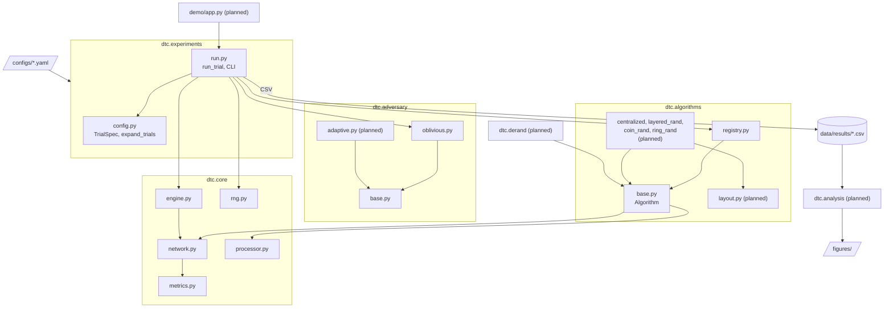
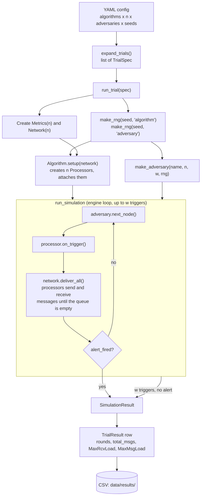
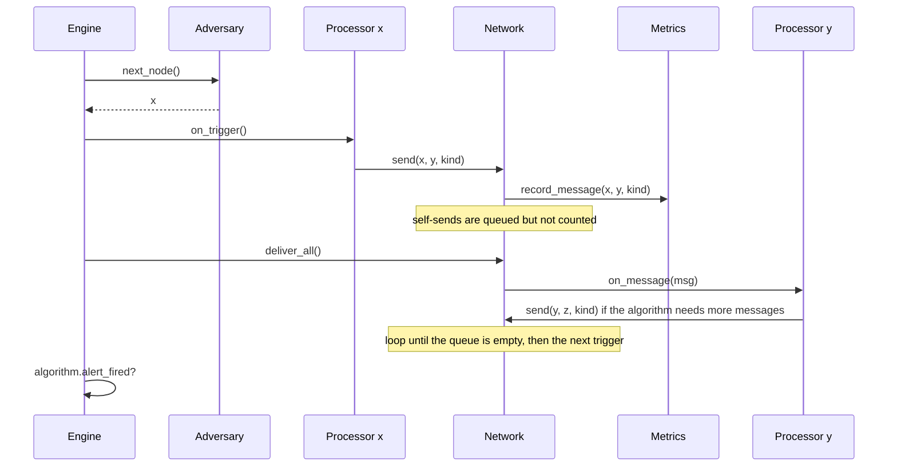
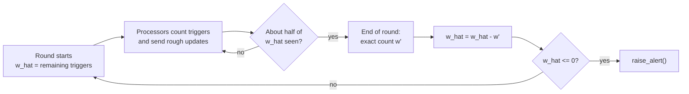
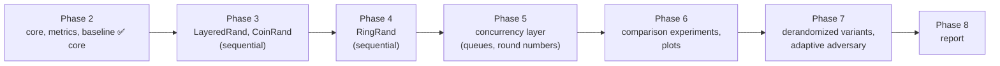

# System Architecture

How the simulator is put together, following the design in [PROJECT_PLAN.md](../PROJECT_PLAN.md) (section 4.1). Source lives in `src/dtc/`.

Status key: ✅ implemented, ⏳ planned (file exists as a stub).

## 1. Component table

| Piece | File | What it does | Status |
|---|---|---|---|
| Seeded randomness | [core/rng.py](../src/dtc/core/rng.py) | `make_rng(seed, stream)` gives the algorithm and the adversary separate random streams. Changing the algorithm doesn't change the trigger sequence. | ✅ |
| Fully connected network | [core/network.py](../src/dtc/core/network.py) | `Network(n)` lets any processor `send` to any other and counts every message. Trees and rings are overlays in `algorithms/layout.py`. | ✅ |
| Metrics | [core/metrics.py](../src/dtc/core/metrics.py) | Per-processor sent and received counts, from which total messages, MaxRcvLoad and MaxMsgLoad are computed. | ✅ |
| Processor base class | [core/processor.py](../src/dtc/core/processor.py) | The `on_trigger()` and `on_message()` hooks that algorithms fill in. | ✅ |
| Engine | [core/engine.py](../src/dtc/core/engine.py) | Gives the adversary's next trigger to a processor, finishes all messages it causes, then repeats. Stops at the alert or after `w` triggers. | ✅ |
| Algorithm interface | [algorithms/base.py](../src/dtc/algorithms/base.py), [registry.py](../src/dtc/algorithms/registry.py) | An abstract `Algorithm` with `create_processors`, `raise_alert` and `start_round`. A registry maps names like `"coin_rand"` to classes. | ✅ |
| Adversaries | [adversary/oblivious.py](../src/dtc/adversary/oblivious.py), [base.py](../src/dtc/adversary/base.py), [\_\_init\_\_.py](../src/dtc/adversary/__init__.py) | `uniform`, `single_node`, `few_nodes`, `bursty` and `permutation`, matching the names in the configs. | ✅ |
| Trial creation | [experiments/config.py](../src/dtc/experiments/config.py) | `TrialSpec` is one trial. `compute_w` turns `w_factor` into `w`, and `expand_trials` expands a YAML config into every trial. | ✅ |
| Trial execution | [experiments/run.py](../src/dtc/experiments/run.py) | `run_trial(spec)` builds everything, runs it, and returns a `TrialResult` matching [DATA_FORMATS.md](DATA_FORMATS.md). | ✅ |
| Experiment CLI (parallel seeds, CSV output) | [experiments/run.py](../src/dtc/experiments/run.py) `main()` | Runs every trial in a config and writes `data/results/<name>.csv`. | ⏳ |
| Layouts (tree and ring overlays) | [algorithms/layout.py](../src/dtc/algorithms/layout.py) | Layer and index math for `n = 2^L - 1` and `n = 2^L`, and ring order. | ⏳ |
| Centralized baseline | [algorithms/centralized.py](../src/dtc/algorithms/centralized.py) | Deterministic master-based counter. | ⏳ |
| LayeredRand, CoinRand, RingRand | [layered_rand.py](../src/dtc/algorithms/layered_rand.py), [coin_rand.py](../src/dtc/algorithms/coin_rand.py), [ring_rand.py](../src/dtc/algorithms/ring_rand.py) | The three algorithms (sequential model first). | ⏳ |
| Adaptive adversary | [adversary/adaptive.py](../src/dtc/adversary/adaptive.py) | Aims triggers at processors that tend to receive coins. | ⏳ |
| Derandomized variants | [derand/](../src/dtc/derand) | Deterministic parent-selection and Collection policies. | ⏳ |
| Traces | [core/trace.py](../src/dtc/core/trace.py) | Optional JSONL event traces for the demo. | ⏳ |
| Analysis | [analysis/](../src/dtc/analysis) | Result loading, plots and growth-rate fits. | ⏳ |
| Demo | [demo/app.py](../demo/app.py) | Streamlit app that imports `dtc` directly. | ⏳ |

## 2. Package layers

Arrows mean "imports from". `core` imports nothing from the other packages, so the simulator stays independent of any particular algorithm.

## 3. How one trial runs

This is `run_trial(spec)`. Every step marked "counts" goes through `Network.send`, which is the only place messages are counted.

## 4. Message flow inside one trigger

## 5. Algorithm lifecycle (all algorithms share this shape)

The algorithms differ in the second and third boxes. See [ALGORITHMS.md](ALGORITHMS.md) for each one.

## 6. Build order (from the plan, sections 4.1 and 6)

## 7. Design decisions

- **Sequential delivery.** Each trigger and all its resulting messages finish before the next trigger arrives. The concurrency layer (paper Section 6) will change delivery in `Network.deliver_all`.
- **Complete graph, overlays on top.** `Network` has no adjacency. Trees and rings are defined in `layout.py` and used by the algorithms.
- **Self-messages are free.** A processor messaging itself is delivered but not counted, because one processor can play both a leaf and an internal role in CoinRand.
- **Separate random streams.** The adversary and the algorithm use different streams from the same seed, so algorithms can be compared on identical trigger sequences.
- **Variants raise `NotImplementedError`** in `run_trial` until `dtc.derand` exists.
- **Known config risk.** [smoke.yaml](../configs/smoke.yaml) uses `n: [15]` for every algorithm, but CoinRand needs `n = 2^L`. Resolve this when `layout.py` is written.
